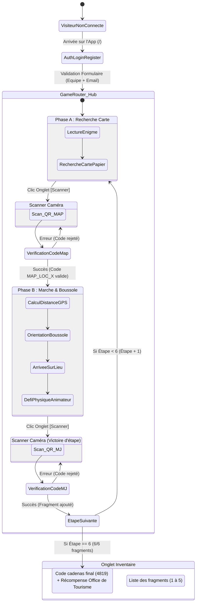

# Cartographie UX, Écrans & Parcours Utilisateur — Expédition Lens

> **Document de cadrage UX/UI pour le refactoring visuel & ergonomique**  
> **Application :** Expédition Lens (Jeu de piste IRL hybride PWA — Destination Lens Tourisme & Asmodee)  
> **Stack technique :** Laravel, Livewire & Alpine.js (Architecture SPA "Islands of Reactivity")

---

## 1. Vue d'Ensemble de l'Architecture Applicative

L'application est conçue comme une **Single Page Application (SPA)** mobile : le navigateur ne recharge jamais la page complète une fois l'utilisateur connecté. La navigation entre écrans est instantanée et gérée côté client via Alpine.js (`x-show`), garantissant la persistance des capteurs (caméra, géolocalisation, boussole) et la réactivité en zone 4G instable.

### Les 2 Routes Web existantes

| Route | Nom de Route | Accès | Rôle & Description |
|---|---|---|---|
| `/` | `home` | Public / Joueur | **Point d'entrée unique de la PWA**. Affiche l'écran d'authentification si non-connecté, ou le routeur SPA de jeu (`GameRouter`) si connecté. |
| `/test-qr` | `test.qr` | Outil de test (Dev/Debug) | **Planche des 12 QR codes officiels** (`MAP_LOC_1..6` et `MJ_STEP_1..6`) affichée sur PC pour être scannée en direct par le smartphone. |

---

## 2. Inventaire Détaillé des Écrans, Composants & Modales

```
┌────────────────────────────────────────────────────────────────────────┐
│                              APPLICATION                               │
├───────────────────────────────────┬────────────────────────────────────┤
│         ÉTAT NON-CONNECTÉ         │           ÉTAT CONNECTÉ            │
│  (Écran 1 : Connexion / Équipe)   │       (SPA GameRouter persistant)  │
│                                   ├────────────────────────────────────┤
│                                   │ • Header global & progression      │
│                                   │ • Onglet A : Boussole / Hub        │
│                                   │ • Onglet B : Scanner Caméra        │
│                                   │ • Onglet C : Inventaire / Climax   │
│                                   │ • Bottom Navigation Bar fixe       │
└───────────────────────────────────┴────────────────────────────────────┘
```

---

### Écran 1 : Connexion / Inscription Équipe (`Auth.LoginRegister`)

* **Composant Livewire :** `App\Livewire\Auth\LoginRegister`
* **Fichier vue :** `resources/views/livewire/auth/login-register.blade.php`
* **Accès :** Automatique si `!Auth::check()` sur la route `/`.
* **Rôle :** Permettre à une famille d'entrer directement dans le jeu sans mot de passe complexe. Si l'email existe, elle reprend sa partie en cours là où elle s'était arrêtée. Sinon, l'équipe est créée à l'étape 1.

#### Éléments de contenu & contrôles :
* **Titre :** *Connexion / Inscription Équipe*
* **Champ 1 :** `Nom de l'équipe` (`<input type="text">` relié à `wire:model="team_name"`).
* **Champ 2 :** `Email` (`<input type="email">` relié à `wire:model="email"`).
* **Messages d'erreur :** Affichage contextuel sous chaque champ (`@error`).
* **Bouton d'action :** `<button type="submit">Rejoindre l'aventure</button>`.

#### Redirection & Événements :
* Au clic sur soumettre : validation `validate()`, authentification `Auth::login($user)`, émission de l'événement Livewire `user-logged-in`, puis bascule instantanée sur le routeur de jeu.

---

### Écran 2 : Le Cadre Global du Jeu (`GameRouter`)

* **Composant Livewire :** `App\Livewire\GameRouter`
* **Fichier vue :** `resources/views/livewire/game-router.blade.php`
* **Layout parent :** `resources/views/components/layouts/app.blade.php`
* **Rôle :** Conteneur persistant de l'expérience joueur. Maintient l'état de l'onglet actif (`hub`, `scanner`, `inventory`) sans rechargement de page.

#### Composants fixes de l'interface :
1. **Header supérieur :**
   * Nom du jeu : *"L'Expédition Secrète"*
   * Sous-titre : *"Destination Lens Tourisme & Asmodee — Serrure Numérique & Boussole (Maître du Jeu)"*
   * Nom de l'équipe connectée (`Auth::user()->team_name`)
   * Badge de progression globale :
     * En cours : *(Étape X/6 - Phase : GUESSING_LOCATION | WALKING_TO_TARGET)*
     * Fin de jeu : *(Jeu terminé ! 6/6 fragments débloqués)*
   * Bouton d'action : `[Déconnexion]` (invalide la session et renvoie à l'écran 1).
   * Raccourci dev : `[Planche QR Codes de Test]` (ouvre `/test-qr`).
2. **Zone de contenu dynamique (Main) :**
   * Affiche l'onglet sélectionné (`x-show="tab === '...'"`).
3. **Barre de navigation persistante inférieure (Bottom Navigation Bar) :**
   * Bouton 1 : `[Boussole]` (bascule sur le Hub).
   * Bouton 2 : `[Scanner]` (bascule sur la caméra).
   * Bouton 3 : `[Inventaire]` (bascule sur les fragments).

---

### Écran 3 : Onglet "Boussole" (`Game.Hub`)

* **Composant Livewire :** `App\Livewire\Game\Hub`
* **Fichier vue :** `resources/views/livewire/game/hub.blade.php`
* **Rôle :** Cerveau de guidage du Maître du Jeu (Parent). Son contenu s'adapte dynamiquement selon la phase en cours.

#### Cet écran possède 3 états distincts :

#### État 3.A — Phase `GUESSING_LOCATION` (Recherche sur la carte papier)
* **Objectif :** L'enfant résout l'énigme visuelle avec le filtre optique sur sa carte papier.
* **Contenu affiché :**
  * Nom de l'étape : Ex. *"Étape 1 : Place Jean Jaurès (Étape 1/6)"*
  * Titre de phase : *"Phase A : Recherche sur la carte"*
  * **Énigme textuelle :** Ex. *"Cherchez l'homme de bronze qui veille sur la grande place."*
  * Consigne explicative pour les parents : *"L'Enfant cherche le lieu sur sa carte papier... Le Parent scanne ensuite le QR code correspondant (MAP_LOC_X) dans l'onglet Scanner."*

#### État 3.B — Phase `WALKING_TO_TARGET` (Déplacement physique guidé)
* **Objectif :** Guider la famille en temps réel dans les rues de Lens jusqu'au monument physique.
* **Contenu affiché :**
  * Nom de l'étape et consigne de déplacement vers le lieu réel.
  * **Bouton d'autorisation iOS (si requis) :** *"Activer la boussole (Autorisation capteurs)"*.
  * **Distance dynamique calculée :** Texte brut *"Distance : 342 mètres"* (recalculé à chaque déplacement GPS via la formule Haversine).
  * **Cadran de boussole & Aiguille dynamique :**
    * Rendu en SVG vectoriel pur (cadran circulaire, repère Nord, aiguille directionnelle).
    * Rotation fluide à 60 FPS orientée vers la cible (Bearing azimut compensé par le Heading du gyroscope ou le cap GPS en marche).
    * Indicateur textuel sous l'aiguille : *"Angle vers la cible : 84° \| Cap suivi : 12° (boussole/gps)"*.
  * **Section de débogage manuel (repliable ou masquable) :**
    * Coordonnées cibles de l'étape (Lat/Lng).
    * Champs de simulation manuelle (Lat, Lng, Cap) pour tester sur PC sans bouger.
    * Boutons *"Calculer avec ces coordonnées"* et *"Reprendre capteurs réels"*.

#### État 3.C — Fin de jeu (`isFinished = true`)
* Message invitant l'équipe à se rendre sur l'onglet **[Inventaire]** pour consulter le code final du cadenas.

---

### Écran 4 : Onglet "Scanner" (`Game.Scanner`)

* **Composant Livewire :** `App\Livewire\Game\Scanner`
* **Fichier vue :** `resources/views/livewire/game/scanner.blade.php`
* **Rôle :** Serrure optique numérique. Lit les QR codes physiques trouvés sur la carte ou fournis par l'animateur sur place.

#### Éléments de contenu & contrôles :
1. **Indicateur de phase & attente :**
   * Affiche clairement ce que l'utilisateur doit scanner :
     * Si phase `GUESSING_LOCATION` : *"Scanner le QR Map (`MAP_LOC_X`)"*.
     * Si phase `WALKING_TO_TARGET` : *"Scanner le QR MJ (`MJ_STEP_X`)"*.
     * Si jeu terminé : *"Toutes les étapes validées"*.
2. **Zone de flux vidéo Caméra (`#qr-reader`) :**
   * Active automatiquement la **caméra arrière standard (1x)** sans poser de question ni afficher de menu déroulant.
   * Cadre de visée de scan (250x250).
   * Gestion d'erreur native (si refus de permission caméra).
   * Bouton de reprise d'urgence : `[Réactiver le scanner]`.
3. **Bannières de notification / Feedback :**
   * **Succès :** Ex. *"QR Map validé ! Direction la cible pour l'étape 2 : Gare de Lens."*
   * **Erreur :** Ex. *"Code invalide pour l'étape actuelle. Vous devez scanner le QR code de la carte (MAP_LOC_2)."*
4. **Zone de débogage manuel (pour test sans caméra) :**
   * Champ de saisie : `<input type="text" placeholder="Ex: MAP_LOC_1 ou MJ_STEP_1">`
   * Bouton : `[Simuler le scan]`

---

### Écran 5 : Onglet "Inventaire & Climax" (`Game.Inventory`)

* **Composant Livewire :** `App\Livewire\Game\Inventory`
* **Fichier vue :** `resources/views/livewire/game/inventory.blade.php`
* **Rôle :** Visualiser la progression des fragments découverts et déclencher l'écran de triomphe final.

#### Cet écran possède 2 états mutuellement exclusifs :

#### État 5.A — Inventaire en cours (Moins de 6 fragments)
* **Compteur :** *"Progression : X / 6 fragments débloqués"*
* **Si 0 fragment :** Message d'encouragement (*"Aucun fragment pour le moment..."*).
* **Liste ordonnée des fragments acquis :**
  * Pour chaque fragment : Numéro de l'étape, Nom du monument et fragment de code débloqué (Ex: *Étape 1 : Place Jean Jaurès — Fragment : 4*).

#### État 5.B — Écran de Victoire & Climax (6 fragments débloqués)
* **Titre triomphal :** *"Victoire !"*
* **Félicitations personnalisées :** *"Félicitations à l'équipe [Nom de l'équipe] ! Vous avez triomphé de toutes les étapes et reconstitué le trésor de Lens."*
* **Le Saint Graal :** **Le Code final à 4 chiffres** mis en évidence géante :
  $$\mathbf{4819}$$
* **Consigne physique finale :** *"Rendez-vous à l'Office de Tourisme (Destination Lens) pour ouvrir le véritable cadenas et récupérer votre récompense spéciale Asmodee !"*
* **Historique des 6 fragments récoltés :** Récapitulatif complet de la quête.

---

### Écran 6 (Dev / Support) : Planche de Test des QR Codes (`/test-qr`)

* **Route :** `/test-qr`
* **Fichier vue :** `resources/views/test-qr.blade.php`
* **Rôle :** Page utilitaire grand écran affichant les 12 QR codes sous forme de badges scannables directement depuis un moniteur PC avec un téléphone, avec l'énigme, les coordonnées et les solutions attendues.

---

## 3. Matrice des Transitions d'États & Parcours Utilisateur



---

## 4. Recommandations Clés pour le Rework UX / UI & Design

Ce document servira de base directe pour l'intégration CSS et la refonte ergonomique :

1. **Persistance de la barre de navigation basse (Bottom Bar) :**
   * Sur mobile, le pouce doit accéder naturellement aux 3 onglets principaux : `Boussole`, `Scanner`, `Inventaire`.
   * Ajouter des icônes explicites (ex: Boussole / Viseur QR / Coffre ou Sac à dos) et un badge numérique sur l'inventaire (`3/6`).
2. **Traitement de l'écran Scanner :**
   * Maximiser le viseur caméra pour occuper le centre de l'écran du smartphone.
   * Remplacer les textes d'erreurs bruts par des **toasts/modales non bloquantes** qui disparaissent après 3 secondes avec vibration haptique (`navigator.vibrate([100, 50, 100])`).
   * Cacher la section "Debug manuel" dans un accordéon repliable discret pour ne pas polluer l'expérience joueur.
3. **Traitement de l'écran Boussole (Hub) :**
   * En Phase A : Mettre en valeur l'énigme sous forme de "Parchemin" ou "Carte d'indice".
   * En Phase B : Donner une vraie présence visuelle à la boussole (rose des vents stylisée Asmodee / Lens, effet de relief, aiguille contrastée, affichage imposant de la distance restante "280 m").
4. **Traitement de l'écran de Victoire (Climax) :**
   * Animation festive (confettis, son de coffre qui s'ouvre si audio activé).
   * Affichage du code cadenas `4819` façon "combinaison de coffre-fort" bien lisible pour que l'enfant et les parents puissent l'entrer facilement à l'Office de Tourisme.
5. **Gestion du mode Hors-ligne / Micro-coupures réseau :**
   * Grâce à Alpine.js, la boussole et la navigation entre onglets fonctionnent déjà sans réseau. Prévoir un petit indicateur discret "Mode boussole hors-ligne actif" si la connexion 4G s'interrompt momentanément.

